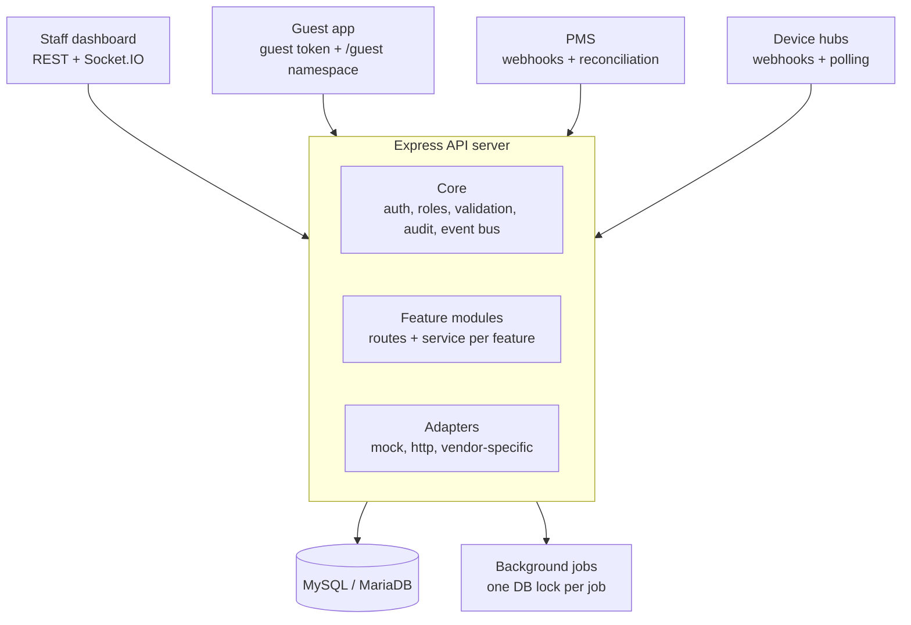
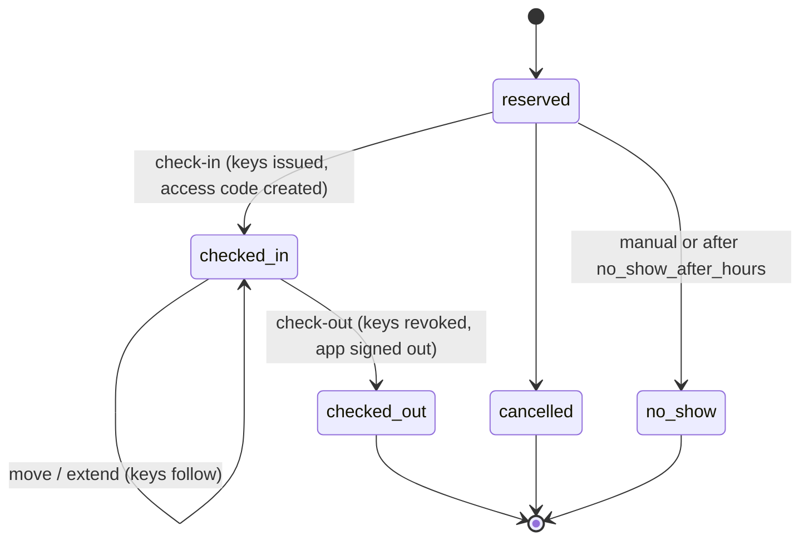

# SmartStay API

Node.js + Express 5 + MySQL/MariaDB API for the SmartStay staff dashboard and guest app (Release 1 and Release 2).

SmartStay connects a hotel's staff, guests, door locks, in-room devices and property management system (PMS)
in one place. Staff see every room live on a board, handle guest requests and maintenance alerts, and run the
front desk. Guests use their phone as a room key and remote control. Rules and energy reports help cut
power use in empty rooms.

## Contents

- [Setup](#setup)
- [Architecture](#architecture)
- [Features at a glance](#features-at-a-glance)
- [API docs for the frontend](#api-docs-for-the-frontend)
- [Roles](#roles)
- [Endpoints](#endpoints)
- [Live updates (Socket.IO)](#live-updates-socketio)
- [Background jobs](#background-jobs)
- [Pilot tools](#pilot-tools)
- [Adding real vendors](#adding-real-vendors)
- [Before going live](#before-going-live)

## Setup

```bash
npm install
cp .env.example .env        # set JWT secrets, DB, SMTP, VAPID keys
npm run migrate             # create tables
npm run seed                # first admin (ADMIN_* in .env), default settings, demo hotel in development
npm run dev                 # http://localhost:5000, restarts on file changes
npm test                    # uses the DB_NAME_TEST database (created automatically)
```

Development logins after seeding: `admin@smartstay.local` / `ChangeMe123!`, and
`service@`, `maintenance@`, `frontdesk@`, `manager@smartstay.local` / `Password123!`.

Works with XAMPP's MariaDB 10.4+ and with MySQL 8.

## Architecture

SmartStay is a modular monolith: one Express process with three layers, backed by one MySQL database.



**Core** (`src/core/`) holds what every feature needs: staff and guest authentication (separate secrets and
audiences), the role permission map, validation, error responses, the audit log, the event bus, sockets and
notifications.

**Feature modules** (`src/modules/`) each own one area, such as rooms, requests, alerts, stays or rules, with a
routes file and a service file. Services contain the business logic and never talk to sockets or email directly.

**Adapters** (`src/adapters/`, `src/pms/`) hide vendor differences. The rest of the code calls methods like
`issueKey`, `revokeKey` or `sendCommand` without knowing which lock or PMS is behind them. The `mock` adapter
is used in development and tests.

### The event bus

When a service changes something (a request is assigned, an alert opens, a guest checks out) it emits one event.
Listeners then:

- push it over Socket.IO, only to the roles allowed to see it,
- send staff notifications (email, browser push) and guest pushes (Firebase),
- write the audit log entry.

Adding a new side effect means adding a listener, not editing every service.

### Guarantees the design relies on

| Guarantee | How it is enforced |
|---|---|
| A room has at most one checked-in stay | Unique database index |
| Only one server runs each background job at a time | MySQL named lock per job (`src/core/`) |
| Every endpoint follows the role map | `tests/permissions.test.js` checks all routes against `src/core/permissions.js` |
| Every route is documented | `tests/openapi.test.js` fails on undocumented routes |
| Each PMS event is applied once, in order | `eventId` deduplication; events older than the last applied change are ignored |
| A guest's access follows their current stay | Every guest call re-checks the stay and room |
| A departed guest's key stops working | Failed revocations raise `key_revoke_failed` and retry every 15 minutes |
| Refresh tokens can't be replayed | Reusing an old refresh token ends all sessions |

### Request flow example

A guest asks for towels from the app:

1. `POST /guest/requests` checks the guest token and that the stay is still checked in.
2. The requests service saves the request and emits `request.created`.
3. Listeners push `request:created` to service staff and managers, play the queue sound, update the room
   on the board (`board:room`) and write the audit log.
4. If nobody picks it up in time, the escalation job raises its priority and notifies again.
5. When staff update it, the guest app receives `request:updated` on the `/guest` namespace and a push notification.

## Features at a glance

| Area | Release | What it does |
|---|---|---|
| Room board and detail | 1 | Every room by floor and status, live; detail shows guest, stay, requests, alerts and devices |
| Requests | 1 | Guest service queue with assignment, priority, history and automatic escalation |
| Alerts | 1 | Device faults, low batteries and offline devices; duplicates grouped; resolving needs a note |
| Feedback | 1 | Guest ratings and photos with averages by day, week or month |
| Staff and security | 1 | Staff accounts, roles, lockout, optional authenticator OTP, browser notifications |
| Settings and mapping | 1 | Hotel settings; floors, room types, adapters, rooms and devices; adapter health |
| Audit log | 1 | Searchable record of staff, guest, device and system actions |
| Front desk and stays | 1 | Reservations, walk-ins, check-in, moves, extensions, check-out, no-shows, availability |
| Digital keys | 1 | Keys issued, moved, extended and revoked through lock adapters; credentials encrypted |
| Guest app | 1 | Sign-in by code, QR or reference; room key; device control; DND and cleaning; requests; feedback |
| PMS sync | 1 | Webhook events and reconciliation; PMS becomes the source of truth in `pms` mode |
| Guest privacy | 1 | Anonymise guests; automatic data retention |
| Rules | 2 | Cron schedules and vacancy rules (for example eco mode in unsold rooms), with run history |
| Energy | 2 | Readings by room or floor, hourly to monthly, top 10 rooms, CSV export |
| Guest preferences | 2 | Saved lights, temperature and music applied at check-in |

## API docs for the frontend

- Interactive docs: `http://localhost:5000/docs` (off in production unless `DOCS_ENABLED=true`).
- OpenAPI spec: `/docs/openapi.json`, or the exported file [docs/openapi.json](docs/openapi.json) (`npm run docs:openapi` to refresh it).
- Integration guide: [docs/FRONTEND_GUIDE.md](docs/FRONTEND_GUIDE.md): sign-in and token refresh, live updates, errors and screen-by-screen calls.
- `tests/openapi.test.js` fails if a route is added without being documented.

## Postman

Import both files in `postman/`, select the "SmartStay Local" environment and run **Auth > Login**.
The token is saved automatically for every other request.

## Structure

```
src/
  config/      env and database (knex)
  core/        auth, role permissions, validation, errors, audit log, event bus,
               sockets, notifications (email, browser push, guest push), DB job lock
  adapters/    device API adapters: mock (dev/tests), http (generic), add vendors in index.js
  pms/         PMS adapters and event handling
  jobs/        device polling, escalation, adapter health, rules runner, energy import
  modules/     one folder per feature: routes + service
db/migrations, db/seeds
scripts/       pilot import tools and device event simulator
tests/         API tests, including a role check on every endpoint
```

## Roles

| Area | service | maintenance | front_desk | manager | admin |
|---|---|---|---|---|---|
| Room board and detail | ✓ | ✓ | ✓ | ✓ | ✓ |
| Requests | ✓ | | | ✓ | ✓ |
| Alerts | | ✓ | | ✓ | ✓ |
| Feedback, audit log, energy | | | | ✓ | ✓ |
| Staff, settings, mapping, rules | | | | | admin |
| Stays, guests, front desk day, availability | | | ✓ | ✓ | ✓ |
| Anonymise guests, PMS connection | | | | | admin |

Guest phone, email and booking reference in room detail are only shown to front desk, manager and admin.

The map lives in `src/core/permissions.js`. `tests/permissions.test.js` checks every endpoint against it.

## Endpoints

All routes also work under `/api` (for example `/api/admin/rooms/board`).
Responses are `{ success, data }` or `{ success: false, code, message, details? }`.
Admin routes need `Authorization: Bearer <accessToken>`.

### Staff sign-in
| Method and path | Purpose |
|---|---|
| POST /staff/login | `{ email, password, otp? }` returns access token, refresh token (also set as httpOnly cookie) and profile. `401 OTP_REQUIRED` when the one-time code is on; `423` when locked |
| POST /staff/refresh | New token pair from the cookie or `{ refreshToken }`. Reusing an old refresh token ends all sessions |
| POST /staff/logout | Ends the session |
| GET /staff/me | Current staff profile |
| POST /staff/me/password | `{ currentPassword, newPassword }` |
| POST /staff/me/otp/setup, /enable, /disable | Authenticator app one-time code |
| GET /staff/push/public-key, POST/DELETE /staff/me/push-subscriptions | Browser notifications |

### Admin (Release 1)
| Method and path | Purpose |
|---|---|
| GET /admin/rooms/board?floor=1,2&status=alert,request&roomType=Suite | Rooms by floor, status and priority order, with counts |
| GET /admin/rooms/{id} | Room detail: guest, stay, open requests, alerts, device states |
| GET /admin/requests?status=&category=&priority=&assignedTo=me&escalated=&roomId=&from=&to= | Request queue with open counts |
| GET /admin/requests/{id} | Request with full history |
| POST /admin/requests | `{ roomId, category, description?, priority? }` on behalf of a guest |
| PATCH /admin/requests/{id} | `{ assignedTo?, status?, priority?, note? }` |
| GET /admin/alerts?status=open&severity=&type=&source=&roomId=&floor= | Alerts, duplicates grouped |
| GET /admin/alerts/{id} | Alert with occurrences and device history |
| PATCH /admin/alerts/{id} | `{ status: "resolved", note }` (note required) |
| GET /admin/feedback?from=&to=&minRating=&maxRating=&floor=&hasPhotos=&groupBy=day\|week\|month | Feedback, photos, averages |
| GET, POST /admin/staff, GET, PATCH /admin/staff/{id} | Staff accounts. PATCH: `name, email, role, isActive, password, resetOtp, unlock` |
| GET, PUT /admin/settings | Hotel settings (PUT accepts partial objects) |
| GET, PUT /admin/rooms/mapping | Floors, room types, adapters, rooms and devices. PUT replaces the whole mapping |
| GET /admin/rooms/mapping/adapters | Adapter health |
| POST /admin/rooms/mapping/adapters/{id}/secret | New webhook secret (shown once) |
| POST /admin/rooms/mapping/adapters/{id}/check | Run a health check now |
| GET /admin/audit?staffId=&actorType=&action=request.&roomNumber=&from=&to=&q= | Audit log search; `action` ending in `.` matches a prefix |

### Admin (Release 2)
| Method and path | Purpose |
|---|---|
| GET, POST /admin/rules, GET, PATCH /admin/rules/{id} | Schedules and vacancy rules |
| GET /admin/rules/{id}/runs, POST /admin/rules/{id}/run | Run history; run now |
| GET /admin/energy?from=&to=&groupBy=room\|floor&interval=hour\|day\|month&floor= | Energy series and top 10 rooms |
| GET /admin/energy/export | Same filters as CSV |

Rule example:
```json
{ "name": "Eco in unsold rooms", "type": "vacancy",
  "target": { "scope": "all" },
  "conditions": { "trigger": "unsold", "delayMinutes": 30 },
  "actions": [{ "type": "set_climate", "mode": "eco" }] }
```
Schedule rules use `"type": "schedule", "cron": "0 23 * * *"` (UTC) and optional `conditions.occupancy`.

### Guests and bookings (front desk)
| Method and path | Purpose |
|---|---|
| GET /admin/front-desk/today | Arrivals (late ones flagged), departures, overdue check-outs, counts |
| GET /admin/rooms/availability?from=&to=&roomType= | Rooms free for the whole range |
| GET /admin/stays?status=&arrivalDate=&departureDate=&inHouse=&roomId=&q= | Search stays (q: name, email, phone, reference, room) |
| GET /admin/stays/{id} | Stay with guests, history, requests, keys, feedback |
| POST /admin/stays | Reservation, or walk-in with `checkInNow: true`. Blocked in PMS booking mode |
| PATCH /admin/stays/{id} | Dates, room (reserved only), guest counts, notes, `addGuests` |
| POST /admin/stays/{id}/check-in | `{ roomId? }`. Returns `accessCode` (shown once), `keys`, `warnings` |
| POST /admin/stays/{id}/move | `{ roomId, reason? }`. Guest requests and keys move; maintenance requests stay |
| POST /admin/stays/{id}/extend | `{ departure }` (also shortens). Keys follow |
| POST /admin/stays/{id}/check-out | Revokes keys and app access, closes guest requests |
| POST /admin/stays/{id}/cancel, /no-show | Reserved stays only |
| POST /admin/stays/{id}/access-code | New guest code; `signOutDevices` signs out phones |
| POST /admin/stays/{id}/keys | Revoke and re-issue digital keys |
| GET, POST /admin/guests, GET, PATCH /admin/guests/{id} | Guest profiles with stay history |
| POST /admin/guests/{id}/anonymise | Admin. Only when the guest has no current or future stay |

Stay lifecycle:



A room can only ever have one checked-in stay (enforced by a unique database index).

**Hotel settings for bookings:** `timezone`, `booking_mode` (`manual` or `pms`), `no_show_after_hours` (0 = off),
`checkout_grace_minutes`, `close_requests_on_checkout`, `email_access_code_to_guest`, `guest_data_retention_days` (0 = keep).

### Guest app
| Method and path | Purpose |
|---|---|
| GET /guest/info | Public: hotel name, reception phone, FAQs, privacy notice, quick links |
| POST /guest/login | `{ bookingCode }` (8 characters, from check-in), `{ qrToken }` (check-in QR) or `{ reference, lastName }` |
| POST /guest/logout | Sign out this phone |
| GET /guest/me | Booking, room, stay dates, room status, key availability, eco state |
| GET /guest/key | Key credentials for the Bluetooth SDK and available unlock methods; only inside the stay window |
| POST /guest/key/unlock | Cloud unlock (`{ deviceId? }`); logged as `room.unlock` |
| GET /guest/devices | Lights, AC, curtains, TV, speaker with state and capabilities |
| POST /guest/devices/{id}/command | Command checked against capabilities and the hotel AC range |
| PUT /guest/room-status | `{ dnd?, cleaningRequested?, note? }`; cleaning creates a housekeeping request |
| GET, POST /guest/requests, GET /guest/requests/{id} | Own requests, with `preferredAt` and a timeline |
| POST /guest/requests/{id}/cancel | While new or assigned |
| POST /guest/feedback | Multipart with up to 3 photos, or JSON; `markAsIssue` also raises an alert |
| PUT /guest/push-token | `{ pushToken, platform }` for request status pushes |
| GET, PUT /guest/preferences | Release 2: lights, temperature, music; applied at check-in or with `applyNow` |

Guest tokens use a separate secret and audience from staff tokens. Every call re-checks that the stay is still
checked in and uses its current room, so moves and check-outs take effect immediately.
`phones_per_room` limits signed-in phones per stay. Ten wrong last names lock that sign-in method for 15 minutes.
Live updates for the app: Socket.IO namespace `/guest` (`device:state`, `room:status`, `request:updated`, `stay:moved`, `session:ended`).
Feedback photos are stored privately in `STORAGE_DIR` (default `./storage`) and shown to staff through signed links.

### Digital keys
Check-in issues a key on every lock in the room through the lock's device adapter (`issueKey`), a move revokes
the old room's keys and issues new ones, an extension updates the end time, and check-out revokes them.
Credentials are stored encrypted (`DATA_ENCRYPTION_SECRET`). A key that can't be issued raises a critical
`key_failed` alert; one that can't be revoked raises `key_revoke_failed` and is retried every 15 minutes.

### PMS sync
| Method and path | Purpose |
|---|---|
| GET, POST /admin/pms/connections, PATCH /admin/pms/connections/{id} | Connection settings (vendor `http` or `mock`) |
| POST /admin/pms/connections/{id}/secret | Webhook secret (shown once) |
| POST /admin/pms/connections/{id}/sync | Reconcile in-house guests now |
| GET /admin/pms/events?status=failed, POST /admin/pms/events/{id}/retry | Event log and retry |
| POST /integrations/pms/{id}/events | Webhook, header `X-PMS-Secret`, body `{ events: [{ eventId, type, occurredAt, reservation }] }` |

Event types: `reservation.upsert`, `reservation.cancelled`, `reservation.no_show`, `stay.checked_in`,
`stay.checked_out`, `stay.room_moved`. Each event carries the full reservation (see `src/pms/index.js`),
each `eventId` is processed once, and events older than the last applied change are ignored.
PMS rooms match SmartStay rooms by `rooms.pms_code`, or by room number.
Set `booking_mode` to `pms` once the PMS is live: staff can still check in and out as a fallback,
and those changes are marked as manual overrides in the stay history.

### Device integrations
`POST /integrations/adapters/{id}/events` with header `X-Adapter-Secret` and body
`{ events: [{ externalId, type, payload?, occurredAt? }] }`.
Types: `status, online, offline, fault, low_battery, unlock, dnd_on, dnd_off, presence`.
Faults, low battery and devices going offline create alerts. Unlocks go to the audit log.

## Live updates (Socket.IO)

Connect to the API origin with `io(url, { auth: { token: accessToken } })`. Events are sent only to roles allowed to see them:

| Event | Payload | Who |
|---|---|---|
| `board:room` | room summary, same shape as the board | board |
| `board:refresh` | `{}`, reload the board after a mapping change | board |
| `request:created` / `request:updated` | request | requests |
| `alert:created` / `alert:updated` | alert | alerts |
| `feedback:created` | feedback | feedback |
| `adapter:health` | `{ adapterId, from, to }` | admin |
| `rule:run` | `{ ruleId, run }` | admin |
| `stay:updated` | `{ stayId, action }`, reload that stay | front desk |
| `notification` | `{ title, body, data }`. `data.sound` means play the queue sound | per role |

Reconnect with a fresh token after refreshing it.

## Background jobs

Started with the server (`JOBS_ENABLED=true`). Each job holds a MySQL lock while running, so several API servers can run safely.

| Job | Default interval |
|---|---|
| Device polling | 5 s |
| Request escalation | 30 s |
| Adapter health | 60 s |
| Rules (schedules and vacancy) | 60 s |
| Energy import | 60 min |
| No-shows, key revocation retries, guest data retention | 15 min |
| PMS reconciliation | 10 min |

## Pilot tools

```bash
npm run import:mapping -- mapping.csv [--merge]   # room,floor,floor_name,room_type,adapter,adapter_vendor,device_type,external_id,device_name
npm run import:staff -- staff.csv                 # name,email,role,password (blank = generated)
npm run import:energy -- readings.csv             # room,period_start,kwh,external_id
npm run device:event -- 101 lock fault '{"message":"Motor jammed"}'
```

## Adding real vendors

- **Door locks:** implement `issueKey`, `updateKey`, `revokeKey` and `unlock` in a device adapter (`src/adapters/`), or point the `http` adapter at a bridge that follows its contract.
- **PMS:** add a class to `src/pms/index.js` that returns normalised reservations, or use the `http` PMS with a bridge. Webhook events use the format above.
- **Guest push:** needs a Firebase service account file in `FIREBASE_SERVICE_ACCOUNT`.

## Before going live

Things to confirm for each pilot property:

- **Lock behaviour offline.** Check how the chosen lock vendor handles revoking a key when the lock is offline,
  and how long until the revoke reaches the door. Watch `key_revoke_failed` alerts during the pilot.
- **PMS override policy.** Agree with the hotel what should happen when staff check a guest in or out by hand
  and the PMS later sends a different state.
- **Polling load.** Device polling runs every 5 seconds. Measure database and vendor API load at the pilot's
  room count before scaling to larger properties, and prefer webhooks where the vendor supports them.
- **Data protection.** Set `guest_data_retention_days` and the guest privacy notice to match the data
  protection law where the hotel operates (for example the Nigeria Data Protection Act 2023, or GDPR in the EU).
- **Secrets.** Set unique values for the JWT secrets, `DATA_ENCRYPTION_SECRET`, VAPID keys and every adapter
  and PMS webhook secret. Keep `DOCS_ENABLED` off in production unless needed.